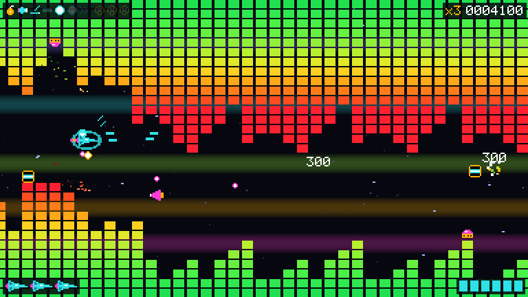

# Pattern Break

[](LICENSE)



A side-scrolling neon tunnel shooter where every level is built from a song. The songs are
tracker modules, often called mods: music files made in a tracker, a program that arranges
short sound samples into patterns of notes and beats. The formats are MOD, XM, S3M, and IT.

The ceiling and floor are the song's left and right spectrum, drawn as LED meter bars, one
bar per row of the song, so the tunnel moves with the beat. The notes in its patterns will
spawn the enemies. The same file always makes the same level, so every song gets its own
leaderboard.

## Status

An early playable slice: title music with an attract demo, an arcade run of levels and a
practice mode, the LED tunnel scrolling in time with the music, a ship you fly through it,
game over and retry, and a jukebox for listening to the songs. There are no enemies, shooting, or scores yet;
those come next, in M2. Level data comes out byte-for-byte the same in Node, Chromium,
Firefox, and WebKit, which is what lets one song have one leaderboard.

- [Roadmap](docs/ROADMAP.md): what comes next
- [Changelog](docs/CHANGELOG.md): what is finished
- [Plan](docs/PLAN.md): the design and the tech choices

## Development

You need Node 26 and pnpm 12. Node runs the TypeScript packages directly, so only the
browser client has a build step.

```sh
pnpm install
pnpm dev          # play it: open the printed address
pnpm check        # lint, type-check, tests, and the docs and music checks
```

Setup, the project layout, and the checks are in the
[development guide](docs/DEVELOPMENT.md). Before writing docs, comments, or anything a
player reads, read the [writing guide](docs/DOC-STYLE.md).

## License

Pattern Break is free and open source. The code is [MIT](LICENSE). Bundled music keeps its
own licenses, listed in `music/manifest.json` and shown in the game. The three songs so far
are Public Domain:

- [Numen in Da Chip](https://modarchive.org/index.php?request=view_by_moduleid&query=169046) by [JAM](https://modarchive.org/member.php?81691)
- [The_Epic_Chip](https://modarchive.org/index.php?request=view_by_moduleid&query=172424) by [Drozerix](https://modarchive.org/member.php?84702)
- [Keygen 9000](https://modarchive.org/index.php?request=view_by_moduleid&query=173938) by [Drozerix](https://modarchive.org/member.php?84702)
